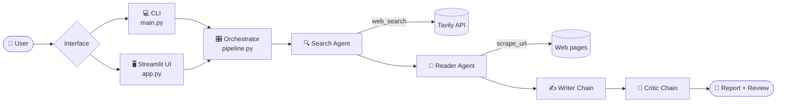

<div align="center">

# 🔬 Research Agent

### A multi-agent research assistant built with LangChain, OpenAI and Streamlit

*Four specialized AI agents collaborate — searching, reading, writing and critiquing — to deliver a polished research report on any topic.*

[](https://www.python.org/)
[](https://www.langchain.com/)
[](https://platform.openai.com/)
[](https://streamlit.io/)
[](LICENSE)
[](#-contributing)

[✨ Features](#-features) •
[🚀 Quickstart](#-quickstart) •
[🏗️ Architecture](#️-architecture) •
[🤝 Contributing](#-contributing) •
[💬 Support](#-support)

</div>

---

## 📖 Table of Contents

- [🌟 Overview](#-overview)
- [✨ Features](#-features)
- [📸 Demo](#-demo)
- [🏗️ Architecture](#️-architecture)
- [⚙️ How It Works](#️-how-it-works)
- [🧰 Tech Stack](#-tech-stack)
- [📋 Prerequisites](#-prerequisites)
- [🚀 Quickstart](#-quickstart)
- [🔐 Configuration](#-configuration)
- [📁 Project Structure](#-project-structure)
- [🛠️ Troubleshooting](#️-troubleshooting)
- [🗺️ Roadmap](#️-roadmap)
- [🤝 Contributing](#-contributing)
- [🛡️ Security](#️-security)
- [📜 License](#-license)
- [🙏 Acknowledgements](#-acknowledgements)
- [💬 Support](#-support)

---

## 🌟 Overview

**Research Agent** is an open-source multi-agent workflow that automates web research end to end. Give it a topic and it will:

- 🔍 **Search** the web for recent, reliable sources
- 📄 **Scrape** the most relevant page using robust extraction strategies
- ✍️ **Draft** a structured research report
- 🧐 **Critique** the draft and score its quality

Run it from the **command line** for quick results, or through the **Streamlit UI** for a live, presentation-ready experience.

---

## ✨ Features

| | Feature | Description |
|---|---|---|
| 🤖 | **Multi-agent pipeline** | LangChain agents and chains, each with a single clear responsibility |
| 🌐 | **Live web search** | Powered by the Tavily Search API |
| 🧹 | **Robust scraping** | Layered extraction with trafilatura → readability-lxml → BeautifulSoup |
| 📝 | **Writer + Critic** | A drafting chain plus a reviewing chain that scores and gives feedback |
| 🟢 | **Live pipeline status** | Each agent shows a status light: waiting, running, done or failed |
| 📑 | **Tabbed results** | Report, critic review and raw sources, neatly separated |
| ⬇️ | **Export** | Download the final report as Markdown |
| 💻 | **CLI mode** | A simple entrypoint for scripted or quick runs |

---

## 📸 Demo

> 💡 *Add a screenshot or GIF of the Streamlit app here.*

```markdown

```

---

## 🏗️ Architecture



<details>
<summary>📝 Plain-text version</summary>

```
User
  └─> Interface
       ├─ CLI (main.py)
       └─ Streamlit UI (app.py)

Orchestrator (src/pipeline/pipeline.py)
  ├─ Search Agent (LangChain Agent)
  │    └─ Tool: web_search → Tavily API
  ├─ Reader Agent (LangChain Agent)
  │    └─ Tool: scrape_url → requests + trafilatura + readability + bs4
  ├─ Writer Chain (LLM)
  └─ Critic Chain (LLM)

LLM Provider: OpenAI (gpt-4o-mini)
```

</details>

---

## ⚙️ How It Works

| Step | Agent | What it does |
|:---:|---|---|
| 1️⃣ | 🔍 **Search Agent** | Uses Tavily to fetch recent, relevant sources for the topic |
| 2️⃣ | 📄 **Reader Agent** | Picks the most promising URL and scrapes it, falling back through trafilatura → readability → BeautifulSoup to maximize extraction quality |
| 3️⃣ | ✍️ **Writer Chain** | Drafts a structured report (introduction, key findings, conclusion, sources) from the combined search and scraped content |
| 4️⃣ | 🧐 **Critic Chain** | Reviews the report and returns a score with constructive feedback |

---

## 🧰 Tech Stack

- 🐍 **Python 3.11**
- 🦜 **LangChain** — core, community and openai packages
- 🧠 **OpenAI** — chat models via `langchain-openai`
- 🎈 **Streamlit** — web UI
- 🔎 **Tavily Search** — web search API
- 🕸️ **Scraping** — requests, trafilatura, readability-lxml, BeautifulSoup, lxml
- 🔑 **python-dotenv** — environment management
- 🎨 **rich** — pretty console logging

---

## 📋 Prerequisites

- ✅ Python **3.11** (recommended)
- ✅ An **OpenAI API key** — [get one here](https://platform.openai.com/api-keys)
- ✅ A **Tavily API key** — [get one here](https://tavily.com/)
- ✅ Streamlit **1.39 or newer** (required by the UI's card styling)

---

## 🚀 Quickstart

### 1️⃣ Clone the repository

```bash
git clone https://github.com/lucky0731/Multi-agent-research-assistant-using-Lang-chain.git
cd Multi-agent-research-assistant-using-Lang-chain
```

### 2️⃣ Create and activate a virtual environment

**Using Conda**

```bash
conda create -n langagent python=3.11 -y
conda activate langagent
```

**Or using venv**

```bash
python -m venv .venv

# 🪟 Windows
.venv\Scripts\activate

# 🍎 macOS / 🐧 Linux
source .venv/bin/activate
```

### 3️⃣ Install dependencies

```bash
pip install -r requirements.txt
```

### 4️⃣ Configure environment variables

```bash
cp .env.example .env        # Windows PowerShell: Copy-Item .env.example .env
```

Then open `.env` and add your keys:

```env
OPENAI_API_KEY=your_openai_api_key
TAVILY_API_KEY=your_tavily_api_key
```

### 5️⃣ Run it

**🖥️ Streamlit app (recommended)**

```bash
streamlit run app.py
```

The UI opens at 👉 **http://localhost:8501**

**💻 CLI pipeline**

```bash
python main.py
```

Edit `main.py` to change the topic, or call the pipeline from your own code:

```python
from src.pipeline.pipeline import run_research_pipeline

run_research_pipeline("Future of LLMs in the tech industry")
```

---

## 🔐 Configuration

| Variable | Required | Description |
|---|:---:|---|
| `OPENAI_API_KEY` | ✅ | OpenAI API key used by `ChatOpenAI` (default model: `gpt-4o-mini`) |
| `TAVILY_API_KEY` | ✅ | Tavily Search API key used by the `web_search` tool |

> ⚠️ **Never commit real secrets.** `.env` is already in `.gitignore`. If a key is ever exposed, rotate it immediately.

---

## 📁 Project Structure

```
.
├── 🖥️ app.py                  # Streamlit UI
├── 💻 main.py                 # CLI entrypoint
├── 📦 requirements.txt        # Python dependencies
├── 📂 src/
│   ├── 🤖 agents/
│   │   └── agents.py          # Search agent, reader agent, writer & critic chains
│   ├── 🎛️ pipeline/
│   │   └── pipeline.py        # Orchestrates search → read → write → critique
│   └── 🧰 tools/
│       └── tools.py           # web_search (Tavily) and scrape_url implementations
├── 🔑 .env.example            # Template for environment variables
├── 🙈 .gitignore
└── 📜 LICENSE                 # Apache-2.0
```

---

## 🛠️ Troubleshooting

<details>
<summary>🚪 <b>Streamlit doesn't open</b></summary>

Make sure port 8501 is free, or run on another port:

```bash
streamlit run app.py --server.port 8502
```
</details>

<details>
<summary>🚫 <b>HTTP 403 or timeouts while scraping</b></summary>

Some sites block bots. Try a different topic, different sources, or another network.
</details>

<details>
<summary>⏱️ <b>Rate limit errors</b></summary>

Both OpenAI and Tavily enforce rate limits. Add delays between runs or upgrade your plan.
</details>

<details>
<summary>🔒 <b>SSL errors on Windows</b></summary>

Keep `certifi` and `requests` up to date:

```bash
pip install -U certifi requests
```
</details>

<details>
<summary>🎨 <b>UI cards look unstyled</b></summary>

The UI needs Streamlit 1.39 or newer:

```bash
pip install -U streamlit
```
</details>

---

## 🗺️ Roadmap

- [ ] 🔗 Scrape and merge multiple sources instead of one
- [ ] 🔁 Let the critic's feedback trigger an automatic rewrite
- [ ] 🧠 Support more LLM providers (Anthropic, local models)
- [ ] 📄 Export reports to PDF and DOCX
- [ ] 🧪 Add tests and CI

> 💡 Have an idea? [Open an issue](../../issues) and let's discuss it!

---

## 🤝 Contributing

Contributions are what make open source great, and **all contributions are welcome** — bug fixes, features, docs or ideas. 🎉

1. 🍴 **Fork** the repository
2. 🌿 **Create** a feature branch
   ```bash
   git checkout -b feature/amazing-feature
   ```
3. 💾 **Commit** your changes
   ```bash
   git commit -m "Add amazing feature"
   ```
4. 📤 **Push** to your branch
   ```bash
   git push origin feature/amazing-feature
   ```
5. 🔃 **Open a Pull Request**

**Guidelines**

- 🐛 For bugs or larger changes, open an issue first to describe the problem or proposal
- 🎯 Keep pull requests focused on a single change
- 📝 Update documentation when behaviour changes
- 🙌 Be respectful and constructive in all discussions

---

## 🛡️ Security

If you discover a security vulnerability, **please don't open a public issue.** Instead, report it privately through GitHub's [security advisories](../../security/advisories/new) so it can be fixed before disclosure.

---

## 📜 License

Distributed under the **Apache License 2.0**. See [`LICENSE`](LICENSE) for details.

You're free to use, modify and distribute this project, including commercially, as long as you keep the license and copyright notices.

---

## 🙏 Acknowledgements

This project stands on the shoulders of some excellent open-source tools and services:

- 🦜 [**LangChain**](https://www.langchain.com/) — the agent and chain framework, and its community packages
- 🧠 [**OpenAI**](https://openai.com/) — the language models behind the writer and critic
- 🔎 [**Tavily**](https://tavily.com/) — fast, LLM-friendly web search
- 🎈 [**Streamlit**](https://streamlit.io/) — for making a polished UI simple
- 🧹 [**trafilatura**](https://github.com/adbar/trafilatura), [**readability-lxml**](https://github.com/buriy/python-readability) and [**Beautiful Soup**](https://www.crummy.com/software/BeautifulSoup/) — reliable content extraction
- 🎨 [**rich**](https://github.com/Textualize/rich) — beautiful terminal output
- 🎨 [**Shields.io**](https://shields.io/) — README badges

---

## 💬 Support

Need help or want to share feedback?

- 🐛 **Found a bug?** [Open an issue](../../issues/new)
- 💡 **Have a feature idea?** [Start a discussion](../../discussions)
- ⭐ **Like the project?** Give it a star — it helps others find it!
- 🔁 **Share it** with anyone who might find it useful

---

<div align="center">

### 👨‍💻 Author

**Lucky Agrawal**

<a href="https://github.com/lucky0731">
  
</a>

[](https://github.com/lucky0731)
[](https://www.linkedin.com/in/lucky-agrawal/)

<br/>

Made with ❤️ and ☕ using LangChain & Streamlit

⭐ **If you found this useful, please star the repo!** ⭐

</div>